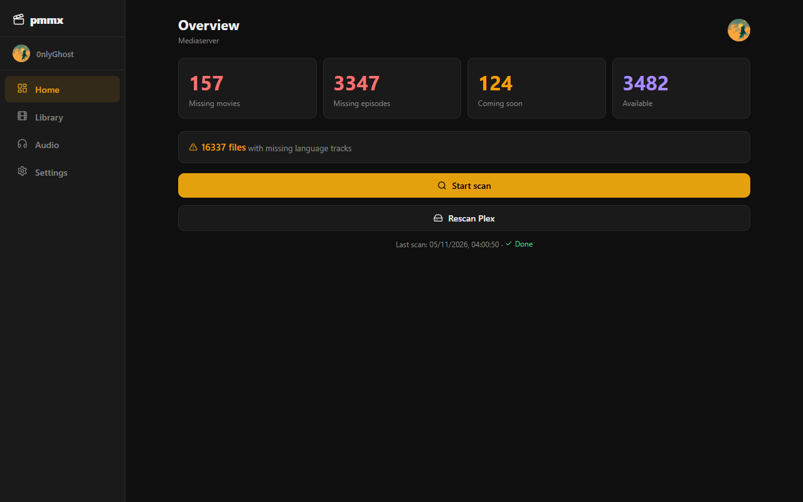
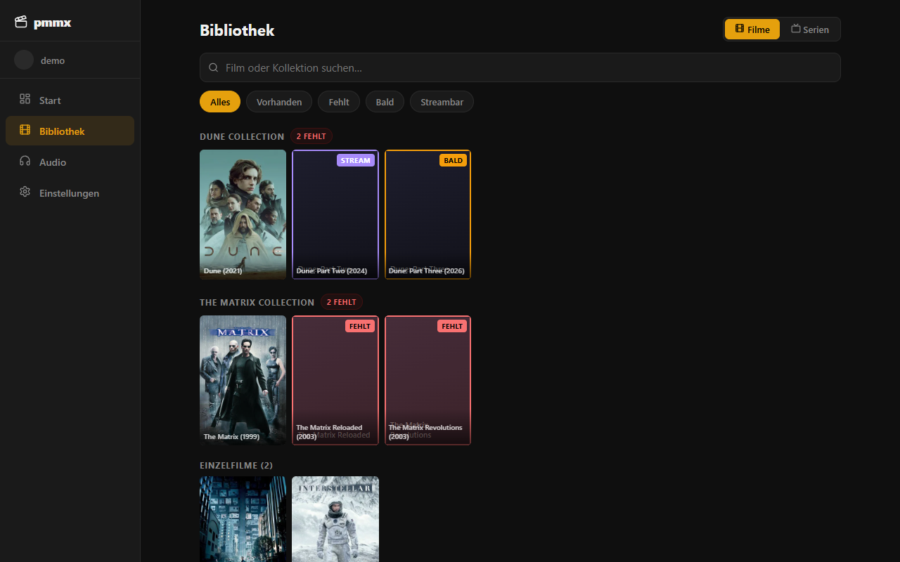
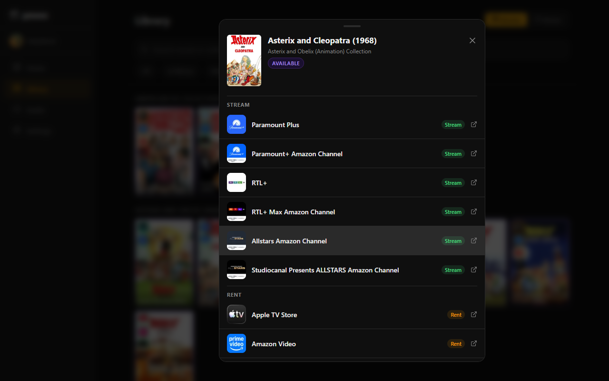
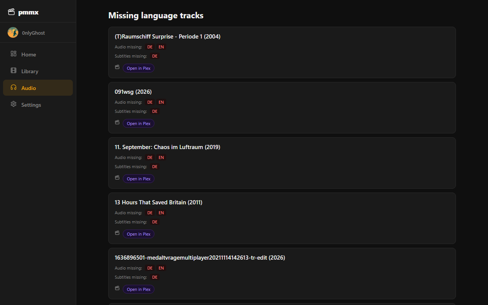
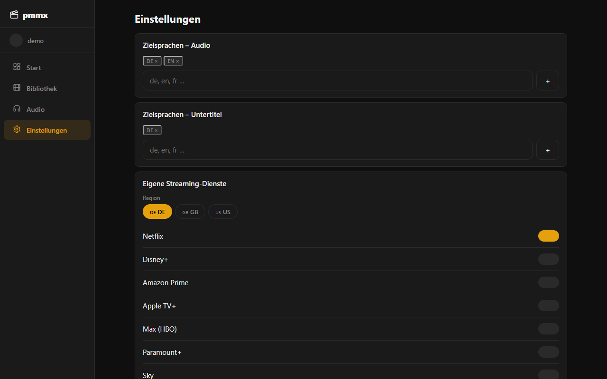
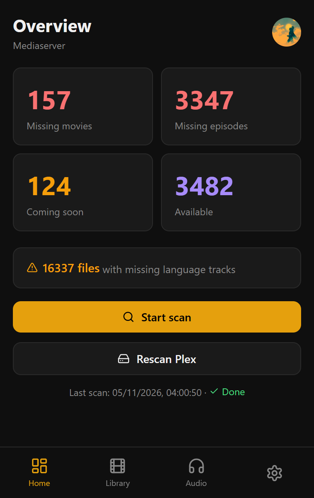

# pmmx – Plex Missing-Media-Scanner

pmmx scannt deine Plex-Bibliothek und zeigt dir, was fehlt: unvollständige Film-Reihen, fehlende Serienepisoden und Dateien ohne die gewünschten Audio- oder Untertitelsprachen. Für fehlende Titel prüft es außerdem, bei welchem Streaming-Dienst sie verfügbar sind.

<p align="center">
  
</p>

> Die Screenshots zeigen die Oberfläche mit Demodaten.

## Features

- **Fehlende Filme:** Erkennt Lücken in Film-Reihen über TMDb-Collections, z. B. fehlende Fortsetzungen oder Vorgänger.
- **Fehlende Episoden:** Vergleicht jede Serie mit TMDb und listet fehlende Staffeln und Episoden.
- **Sprachspuren:** Findet Dateien, denen konfigurierte Audio- oder Untertitelsprachen fehlen.
- **Streaming-Verfügbarkeit:** Zeigt per Watchmode, ob ein fehlender Titel im Abo, zum Leihen oder zum Kaufen verfügbar ist.
- **Status "Bald":** Noch nicht erschienene Titel werden getrennt von fehlenden geführt.
- **Benachrichtigungen:** Per ntfy, Discord oder Pushover.
- **Zeitplan:** Täglicher Voll-Scan und Verfügbarkeitsprüfung per Cron.
- **Mehrere Nutzer:** Anmeldung über Plex OAuth, Einstellungen pro Nutzer.
- **Web-App/PWA:** Responsive, mit Sidebar am Desktop und Bottom-Navigation am Smartphone. Native Apps sind per Capacitor vorbereitet.

## Screenshots

| Bibliothek | Streaming-Details |
|---|---|
|  |  |

| Sprachspuren | Einstellungen |
|---|---|
|  |  |

<p align="center">
  
</p>

## Architektur

| Bereich | Technik |
|---|---|
| Backend | Python 3.12, FastAPI, SQLAlchemy (async), APScheduler |
| Datenbank | PostgreSQL 16 |
| Datenquellen | Plex (`plexapi`), TMDb, Watchmode |
| Frontend | React 18, TypeScript, Vite, TanStack Query, Framer Motion |
| Mobile | Capacitor (iOS/Android) |
| Deployment | Docker Compose |

```
app/
├── api/            REST-Endpunkte (auth, library, missing, scan, settings)
├── auth/           Plex-OAuth und JWT
├── plex/           Einlesen der Plex-Bibliothek
├── matching/       Abgleich Plex ↔ TMDb (Filme, Serien)
├── checkers/       Audio- und Untertitelprüfung
├── streaming/      Verfügbarkeit über Watchmode
├── tmdb/           TMDb-Client und Cache
├── scan/           Scan-Ablauf und Fortschritt
├── scheduler/      Cron-Jobs
├── notifications/  ntfy, Discord, Pushover
└── db/             Modelle und Datenbankzugriff
frontend/           React-App
```

## Installation mit Docker

Voraussetzungen: Docker mit Compose und ein [TMDb-API-Key](https://www.themoviedb.org/settings/api).

1. Repository klonen.
2. `.env.example` nach `.env` kopieren und mindestens `SECRET_KEY` und `TMDB__API_KEY` setzen. Für die Streaming-Prüfung kommt `STREAMING__API_KEY` (Watchmode) dazu.
3. Starten:

   ```bash
   docker compose up -d --build
   ```

4. Die Web-App ist unter `http://localhost` erreichbar. Melde dich mit deinem Plex-Konto an und wähle deinen Server aus.

Der Compose-Stack startet die Datenbank, das Backend, das Frontend (nginx) und einen eigenen ntfy-Server auf Port 8080.

## Konfiguration

Die Grundkonfiguration steht in `config.yaml`. Umgebungsvariablen überschreiben diese Werte, verschachtelte Keys werden mit doppeltem Unterstrich getrennt, z. B. `TMDB__API_KEY`.

```yaml
secret_key: "zufälliger-string"

tmdb:
  api_key: "dein-tmdb-key"

scan:
  full_scan_cron: "0 3 * * *"          # täglicher Voll-Scan
  availability_check_cron: "0 2 * * *" # Verfügbarkeitsprüfung
```

Plex-Zugangsdaten gehören nicht in die Konfiguration. Jeder Nutzer meldet sich über den Plex-OAuth-Flow an. Sprachen, Streaming-Dienste, Region und Benachrichtigungen stellst du in der App unter **Einstellungen** ein.

## Entwicklung

Backend (Python 3.12+ und [uv](https://docs.astral.sh/uv/)):

```bash
uv sync
uv run python -m app.server
```

Die API läuft dann auf `http://localhost:8000`. Dafür wird eine erreichbare PostgreSQL-Datenbank benötigt, die URL setzt du über `DATABASE__URL`.

Frontend (Node und pnpm):

```bash
cd frontend
pnpm install
pnpm dev
```

Der Vite-Dev-Server leitet `/api` an `http://localhost:8000` weiter.

Tests und Linting:

```bash
uv run pytest
uv run ruff check .
```

## API

| Endpunkt | Beschreibung |
|---|---|
| `POST /auth/plex/pin`, `GET /auth/plex/poll/{id}` | Plex-OAuth-Anmeldung |
| `GET /auth/me` | Aktueller Nutzer |
| `GET /library/movies`, `GET /library/shows` | Bibliothek mit Status |
| `GET /missing/movies`, `/missing/episodes`, `/missing/audio` | Fehlende Inhalte |
| `POST /scan/trigger`, `GET /scan/progress`, `GET /scan/status` | Scans starten und beobachten |
| `GET/PUT /settings` | Nutzereinstellungen |

## Status

Frühe Version (0.1.0), die aktiv entwickelt wird.
